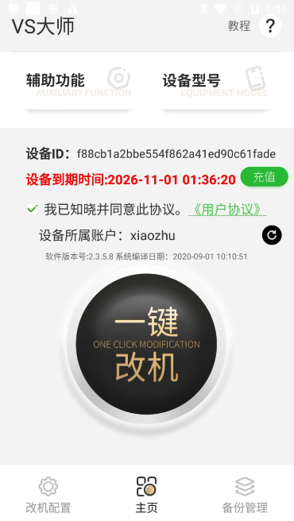
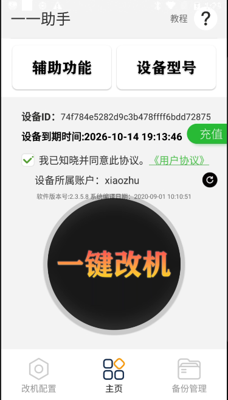
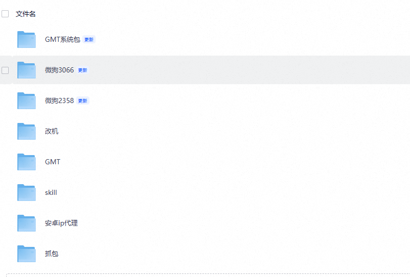

<p align="center">
  
  &nbsp;&nbsp;&nbsp;&nbsp;&nbsp;
  
  &nbsp;&nbsp;&nbsp;&nbsp;&nbsp;
  
</p>

<h1 align="center">GMT 一键新机 · 安卓改机与 iOS 自动化工具</h1>

<p align="center">
  <b>修改 IMEI / IMSI / ICCID / MAC 等 180+ 项设备标识 · 虚拟定位 · 应用多开</b><br>
  安卓端 GMT 一键新机 · VS大师 · 小青蛙 Pro · 一一助手 ｜ iOS 端 XXTouch Lua 脚本
</p>

<p align="center">
  
  
  
  
</p>

---

## 🌐 在线访问

| 入口 | 地址 | 说明 |
| :--- | :--- | :--- |
| **GitHub Pages** | https://ganuidjskd11-afk.github.io/xzgaiji/ | 当前仓库，免费 CDN |

> 纯静态页面，无后端依赖，可直接访问。

---

## ✨ 六大功能模块

| 模块 | 能力 |
| :--- | :--- |
| **设备标识修改** | IMEI / IMSI / ICCID / MAC / 序列号 等 180+ 项参数一次性刷新 |
| **虚拟定位** | 指定经纬度或地图选点，应用层虚拟位置，无需越狱或 Root 之外的额外改动 |
| **应用多开** | 同一设备并行运行多个实例，各自独立环境标识 |
| **机型伪装** | 一键切换设备型号信息，覆盖小米 6（sagit）等目标机型 |
| **iOS 自动化** | XXTouch 提供 Lua 5.3 脚本引擎、操作录制重放、HTTP 二次开发接口 |
| **配套工具链** | VS大师 · 小青蛙 Pro · 一一助手 · 微狗系统，覆盖改机全流程 |

---

## 📱 支持机型

| 平台 | 机型 / 环境 | 前置条件 |
| :--- | :--- | :--- |
| 安卓 | 小米 6（`sagit`） | 需先刷入指定系统镜像 |
| 安卓 | 微狗系统环境 | 配合 VS大师 / 小青蛙 Pro / 一一助手 |
| iOS | XXTouch 运行环境 | 安装 XXTouch 主体，支持 Lua 5.3 |

> 当前仅适配小米 6 `sagit`，其他机型请先确认系统版本与刷机包匹配。

---

## 🖼 产品界面

<table>
  <tr>
    <td align="center" width="33%">
      <br><br>
      <b>VS大师</b><br>
      <sub>辅助功能 · 设备型号</sub>
    </td>
    <td align="center" width="33%">
      <br><br>
      <b>一一助手</b><br>
      <sub>改机配置 · 备份管理</sub>
    </td>
    <td align="center" width="33%">
      <br><br>
      <b>小青蛙 Pro</b><br>
      <sub>扫码充值 · 设备信息</sub>
    </td>
  </tr>
</table>

### ⌬ GMT 一键新机 ｜ XXTouch

<table>
  <tr>
    <td align="center" width="50%">
      <br><br>
      <b>GMT 一键新机</b><br>
      <sub>安卓改机核心 · 修改 IMEI / IMSI / ICCID / MAC 等 180+ 项</sub>
    </td>
    <td align="center" width="50%">
      <br><br>
      <b>XXTouch</b><br>
      <sub>iOS 自动化引擎 · Lua 5.3 · 操作录制重放 · HTTP 接口</sub>
    </td>
  </tr>
</table>

---

## 📦 工具包

<p align="center">
  
</p>

<p align="center">
  <sub>系统包 / 微狗 3066 / 微狗 2358 / 改机 / GMT / skill / 安卓 ip 代理 / 抓包</sub>
</p>

---

## 📁 项目结构

```
xzgaiji/
├── index.html              # 主页面（单页，含全部板块）
├── .nojekyll               # 禁用 Jekyll 处理，保证 assets/ 原样输出
└── assets/
    ├── css/
    │   └── style.css       # 全站样式（35 KB）
    ├── js/
    │   └── main.js         # 交互脚本
    └── img/
        ├── gmt1.jpg         # GMT 一键新机 logo（黑金）
        ├── xxt.webp         # XXTouch logo（蓝白 XXT）
        ├── vs-main.png      # VS大师 界面截图
        ├── helper-main.png  # 一一助手 界面截图
        ├── frog-main.png    # 小青蛙 Pro 界面截图
        ├── tools-main.png   # 工具包文件列表
        ├── frog.webp        # 小青蛙方形图 800×800
        └── biz.svg / tools.svg / vs.png / helper.png
```

---

## 🚀 本地运行

无需构建工具，任意静态服务器即可：

```bash
# 方式一：Python 内置服务器
python3 -m http.server 8080

# 方式二：直接双击 index.html
# 注意：部分浏览器对 file:// 协议加载 CSS/JS 有限制，建议用方式一
```

打开 http://localhost:8080 即可预览。

---

## ⚙️ 部署到自建服务器（Caddy）

```caddyfile
https://your-domain.com {
    root * /var/www/xzgaiji
    encode gzip
    file_server
}
```

```bash
sudo systemctl reload caddy
```

静态站不依赖 PHP、数据库，可直接挂任意 CDN 或对象存储。

---

## 📄 说明

本项目为纯静态展示页面，不含任何后端逻辑与用户数据收集。页面内容用于产品功能说明与使用指引。

配套的业务后台（PHP + SQLite）部署在独立服务器，与本仓库无代码依赖。
